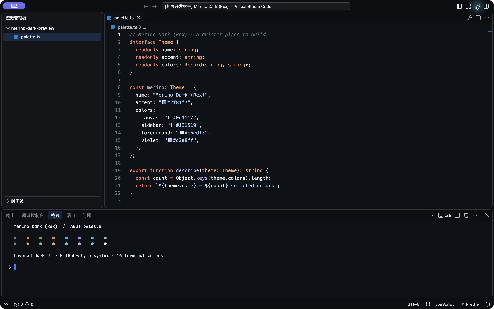

# Merino Dark (Rex)

取自 Rex Beta **Merino Dark** 色板的 VS Code 暗色主题：深色画布、细腻的界面分层，以及 GitHub 风格的语法和终端配色。

A dark VS Code theme based on Rex Beta's Merino Dark palette, with layered UI surfaces, GitHub-style syntax highlighting, and a matching terminal palette.



## 安装 · Install

在扩展面板搜索 **Merino Dark (Rex)**，或运行：

```sh
code --install-extension HUAYANGTIAN.merino-dark-rex
```

安装后打开命令面板，运行 **Preferences: Color Theme**，选择 **Merino Dark (Rex)**。macOS 也可按 `⌘K`、`⌘T`；Windows / Linux 按 `Ctrl+K`、`Ctrl+T`。

Open the Command Palette, run **Preferences: Color Theme**, and select **Merino Dark (Rex)**.

## 配色 · Palette

- **界面**：146 个 UI 颜色令牌，区分编辑器、侧栏、标题栏、面板和浮层。
- **语法**：17 组 TextMate 规则，涵盖注释、字符串、关键字、函数、类型和 Markdown。
- **终端**：完整 16 色 ANSI 色板，使用 GitHub Primer 风格的红、绿、蓝、紫。
- **轻量**：只贡献颜色主题，没有运行时代码，也没有扩展运行时依赖。

| 区域 / Role | 颜色 / Color |
| --- | --- |
| 编辑器 / Editor | `#0d1117` |
| 标题栏与面板 / Title bar & panel | `#0c0e11` |
| 侧栏 / Sidebar | `#131519` |
| 浮层 / Floating surfaces | `#16191e` |
| 正文 / Foreground | `#e6edf3` |
| 强调 / Accent | `#2f81f7` |

UI colors come from Rex Beta's bundled Merino Dark design tokens. Syntax colors use GitHub Dark-style semantic mappings; this is a VS Code adaptation rather than an official Rex extension.

## 本地打包 · Package locally

打包需要 Node.js 22 或更高版本；安装主题不需要 Node.js。

```sh
npm ci
npm run package
code --install-extension ./merino-dark-rex-1.0.0.vsix
```

打包输出为 `merino-dark-rex-1.0.0.vsix`。发布时，在 [Marketplace 发布者管理页](https://marketplace.visualstudio.com/manage) 选择 **HUAYANGTIAN → New extension → Visual Studio Code** 并上传 VSIX；更新已有版本时使用该扩展的更新入口。

The VSIX can also be installed with **Extensions → … → Install from VSIX…**. Packaging uses the pinned VSCE development dependency; the theme itself has no runtime dependencies.

## 反馈 · Feedback

请到 [GitHub Issues](https://github.com/amm10090/merino-dark-vscode/issues) 反馈。颜色问题请附 VS Code 版本、语言、截图，以及是否启用了其他主题或自定义颜色设置。

Report color issues with your VS Code version, language, screenshot, and any theme or color overrides in use.

## 推荐搭配

- 字体：[Maple Mono NF CN](https://github.com/subframe7536/maple-font)
- 图标：[Material Icon Theme](https://marketplace.visualstudio.com/items?itemName=PKief.material-icon-theme)（文件夹色 `#2f81f7`）

## Logo

**Wool Cursor**：一团白色毛线延伸为蓝色终端光标。SVG 源文件位于 `logo/merino-symbol.svg`。

## License & credits

[MIT](LICENSE)。色板来自 Rex Beta 的 Merino Dark 设计令牌，并沿用 GitHub Primer 色彩系统。

Independent community port; not affiliated with or endorsed by GitHub or the Rex developers.
